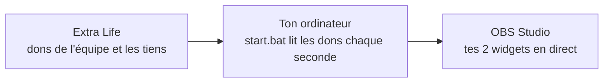

<div align="center">


# Cagnotte 2<sup>e</sup> Vie

**Tes widgets OBS pour la cagnotte Extra Life, où que tu streames.**<br>
La cagnotte de l'équipe et la tienne, en direct sur ton stream,<br>
avec un badge « + XP » à chaque don et un flash à chaque palier franchi.


<br>

[](https://github.com/tristanbest0802-beep/cagnotte-streamer-distance/releases/latest/download/cagnotte-streamer.zip)
&nbsp;
[](Guide-installation-streamer.pdf)

<sub>Environ 30 Mo · toutes les versions dans les <a href="https://github.com/tristanbest0802-beep/cagnotte-streamer-distance/releases">Releases</a></sub>

</div>

---

## En deux mots

| | |
|---|---|
| **Ce que ça fait** | Un petit programme sur ton ordinateur lit les dons Extra Life chaque seconde et met tes deux widgets OBS à jour : la cagnotte globale de l'équipe et la tienne. |
| **Pour qui** | Les streamers de l'équipe 2<sup>e</sup> Vie qui ne sont pas sur le réseau de l'organisateur. |
| **Ce qu'il te faut** | Un PC Windows 10 ou 11, OBS Studio, une connexion internet et ton ID Extra Life. Rien d'autre à installer : le programme s'en charge. |
| **Ce qui reste chez toi** | Ton look, tes réglages et ton ID restent sur ton PC. Personne d'autre ne les voit. |

## Comment ça marche



## Installation en 4 étapes

### 1. Extraire le zip

Clic droit sur `cagnotte-streamer.zip`, puis **Extraire tout**. Range le dossier à un endroit facile, par exemple sur le Bureau : tu le rouvriras avant chaque stream.

> [!WARNING]
> Ne lance rien depuis l'intérieur du zip : le programme ne démarrerait pas correctement.

### 2. Double-cliquer sur `start.bat`

C'est la seule chose à lancer. Au premier lancement, il installe tout seul ce dont il a besoin, Python compris, puis ouvre ta page dans le navigateur.

> [!NOTE]
> **Ce n'est pas un virus.** Windows affiche un avertissement pour tout fichier téléchargé qui n'a pas de signature payante. Clique sur **Exécuter**, ou sur **Informations complémentaires** puis **Exécuter quand même** si la fenêtre est bleue.

Laisse la **fenêtre noire ouverte** pendant tout l'événement : c'est elle qui fait vivre tes widgets. Tu peux la réduire, pas la fermer.

### 3. Entrer ton ID Extra Life

Dans la page qui s'ouvre, tape ton ID ou colle l'adresse de ta page Extra Life, puis **Enregistrer**. Ton ID est le nombre à la fin de l'adresse de ta page de participant :

```
https://www.extra-life.org/participants/521334
```

### 4. Ajouter tes widgets dans OBS

| Réglage | Valeur |
|---|---|
| Source | **Navigateur** (*Sources*, puis **+**) |
| URL | le lien copié dans la page, rubrique *Tous les widgets* |
| Largeur × hauteur | **600 × 260** |
| CSS personnalisé | vide |

Un widget pour la cagnotte de l'équipe, un pour la tienne. Le bouton **Tester** de la page envoie un faux don pour vérifier, jamais compté pour de vrai.

## Pour aller plus loin

| | |
|---|---|
| **Personnaliser** | Onglet *Personnaliser le widget* : thèmes, couleurs, police, devise. **Enregistrer et appliquer** met OBS à jour sans recharger. |
| **Taux USD → CAD** | Onglet *Réglages* : recopie exactement le taux annoncé par l'organisateur, sinon ton total ne sera pas le même que celui des autres. |
| **Les fois suivantes** | Double-clic sur `start.bat`, puis ouvre OBS. Tout est conservé. |
| **Nouvelle version** | Ferme la fenêtre noire, télécharge le nouveau zip et extrais-le au même endroit, en remplaçant les fichiers. Ton ID et ton look sont conservés. |

## Un problème ?

<details>
<summary><b>Le widget affiche « serveur hors ligne »</b></summary>

La fenêtre noire est fermée. Relance `start.bat` : le widget se reconnecte tout seul.
</details>

<details>
<summary><b>Message « ECHEC DE L'INSTALLATION DES DEPENDANCES »</b></summary>

La connexion internet ne fonctionne pas. Vérifie-la, puis relance `start.bat`.
</details>

<details>
<summary><b>Message « PYTHON INTROUVABLE »</b></summary>

C'est rare : l'installation automatique a été bloquée. Double-clique sur `python-3.13.15-amd64` dans le dossier, coche **Add python.exe to PATH**, clique sur **Install Now**, puis relance `start.bat`.
</details>

<details>
<summary><b>Message « Aucun participant … chez Extra Life »</b></summary>

L'ID n'est pas le bon. Vérifie qu'il vient d'une adresse avec `/participants/`, pas `/teams/`. Le lien **Changer d'ID**, en haut de la page, permet de le corriger.
</details>

<details>
<summary><b>Ton total diffère de celui des autres streamers</b></summary>

Vérifie le taux USD → CAD dans *Réglages* : il doit être exactement celui de l'organisateur.
</details>

Toujours bloqué ? Fais une capture d'écran (**Windows + Maj + S**) et envoie-la à l'organisateur, avec une phrase sur ce que tu as fait. Le [guide PDF](Guide-installation-streamer.pdf) détaille chaque étape avec des captures.

---

<div align="center">
<sub>Merci de streamer pour la Cagnotte 2<sup>e</sup> Vie et Extra Life. Bon stream !</sub>
</div>
